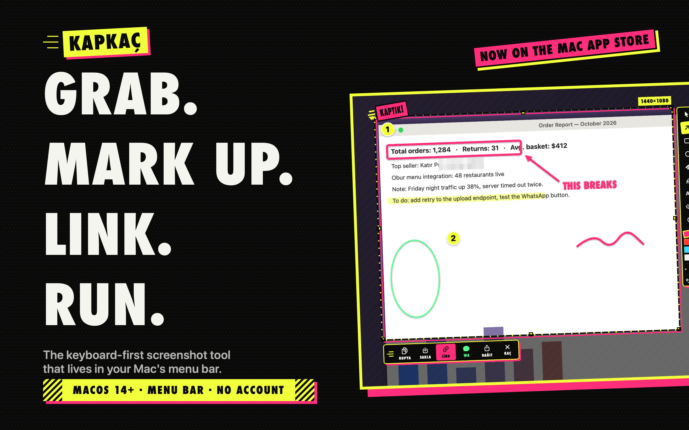
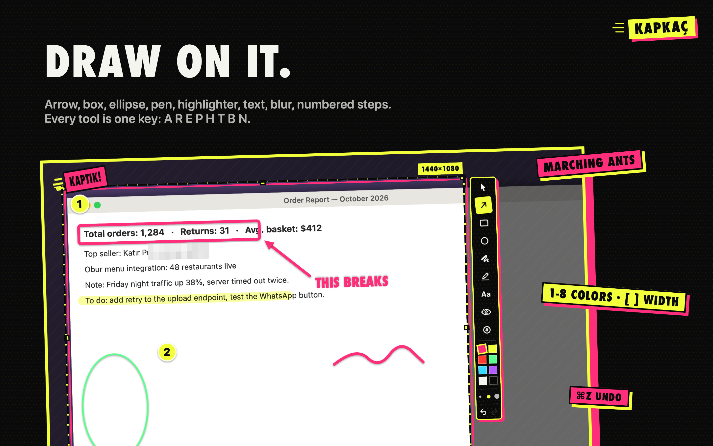
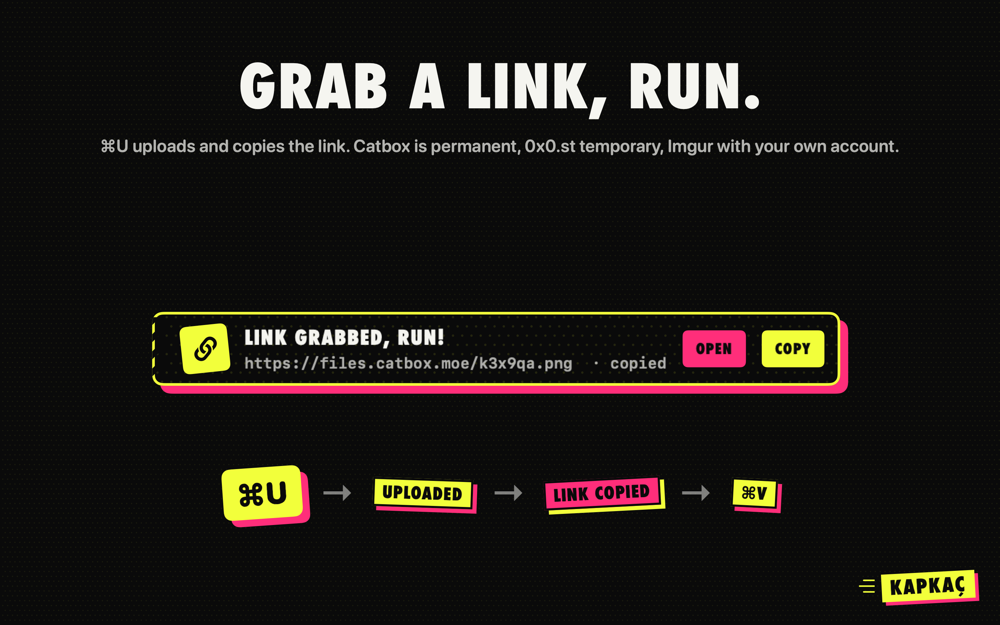
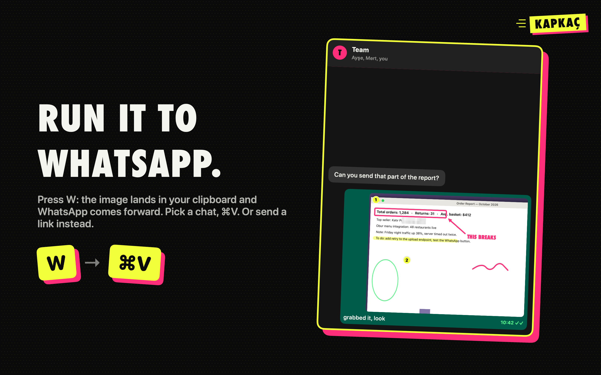
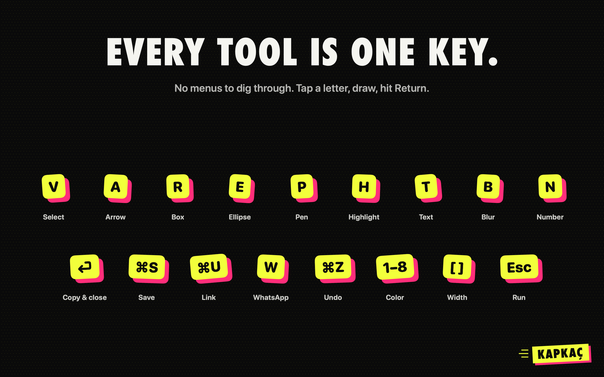
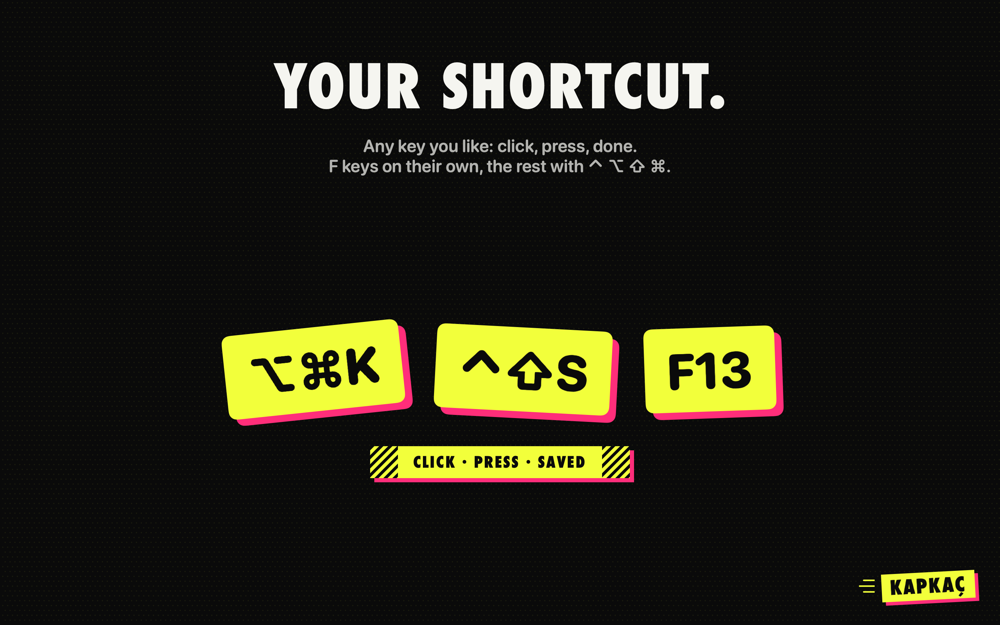
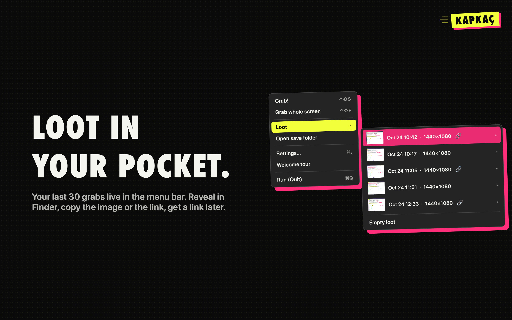
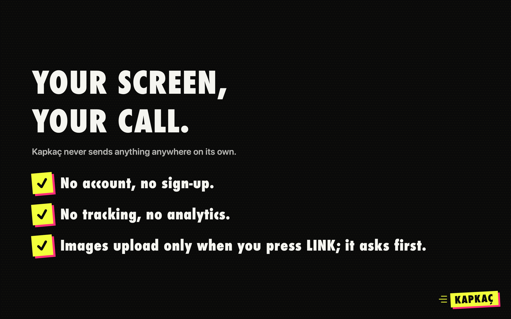
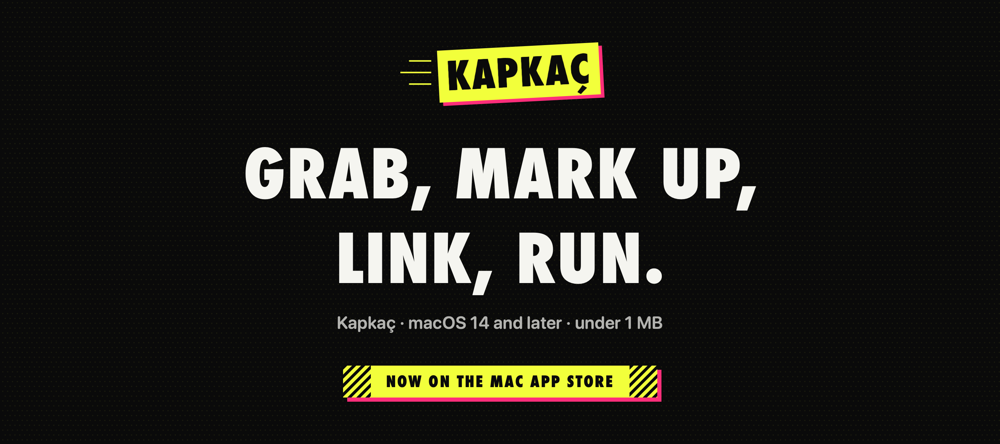

  

  
  
  
  

  <a href="https://kapkac.netlify.app">Website</a>&nbsp;&nbsp;·&nbsp;&nbsp;<a href="https://kapkac.netlify.app/destek/">Support</a>&nbsp;&nbsp;·&nbsp;&nbsp;<a href="https://kapkac.netlify.app/gizlilik/">Privacy</a>&nbsp;&nbsp;·&nbsp;&nbsp;<a href="#kapkaç-in-short">About</a>&nbsp;&nbsp;·&nbsp;&nbsp;<a href="#shortcuts">Shortcuts</a>&nbsp;&nbsp;·&nbsp;&nbsp;<a href="#faq">FAQ</a>&nbsp;&nbsp;·&nbsp;&nbsp;<a href="#türkçe">Türkçe</a>

  

 

## Kapkaç in short

*Kapkaç* (kap-KATCH) is Turkish for snatch-and-run. That is the whole idea: grab the screen, mark it up, get it out of your way.

Press the shortcut and the screen freezes. Drag to select a region, or click once for the whole screen. Draw arrows, boxes, ellipses, text and numbered steps; blur the parts nobody should see. Then press <kbd>⏎</kbd> to copy, <kbd>⌘S</kbd> to save, <kbd>⌘U</kbd> to upload and copy a link, or <kbd>W</kbd> to run it straight to WhatsApp. Three seconds, hands on the keyboard the whole time.

- **Lives in the menu bar.** No Dock icon, no window in the way. Trigger it with a global shortcut, from the menu bar, or from Raycast, Alfred and Shortcuts via `kapkac://` URLs.
- **One key per tool.** <kbd>A</kbd> arrow, <kbd>R</kbd> box, <kbd>E</kbd> ellipse, <kbd>P</kbd> pen, <kbd>H</kbd> highlighter, <kbd>T</kbd> text, <kbd>B</kbd> blur, <kbd>N</kbd> numbered step. Eight colors on <kbd>1</kbd>–<kbd>8</kbd>, three widths on <kbd>[</kbd> <kbd>]</kbd>, undo on <kbd>⌘Z</kbd>.
- **Links without an account.** <kbd>⌘U</kbd> uploads to Catbox (permanent), 0x0.st (expires) or Imgur with your own client ID, then copies the link. Kapkaç asks before the first upload.
- **WhatsApp in one key.** <kbd>W</kbd> copies the image and brings WhatsApp forward; pick a chat and paste. Switch to link mode in Settings if you prefer.
- **Loot.** Your last 30 grabs stay in the menu bar: reveal in Finder, copy the image or the link, or get a link later. A yearly Loot Report sums it up.
- **Yours.** No account, no analytics, no crash reporting. Images leave your Mac only when you explicitly ask for a link. Sandboxed, under 1 MB, native Swift.

## Shortcuts

The default global shortcut is <kbd>⌃⇧S</kbd> for a region and <kbd>⌃⇧F</kbd> for the whole screen. Change either in Settings: click the field, press the combination you want.

| Action | Keys |
|---|---|
| Grab a region / the whole screen | <kbd>⌃⇧S</kbd> / <kbd>⌃⇧F</kbd> |
| Tools | <kbd>V</kbd> select · <kbd>A</kbd> arrow · <kbd>R</kbd> box · <kbd>E</kbd> ellipse · <kbd>P</kbd> pen · <kbd>H</kbd> highlighter · <kbd>T</kbd> text · <kbd>B</kbd> blur · <kbd>N</kbd> number |
| Color / width | <kbd>1</kbd>–<kbd>8</kbd> / <kbd>[</kbd> <kbd>]</kbd> |
| Undo / redo | <kbd>⌘Z</kbd> / <kbd>⇧⌘Z</kbd> |
| Copy and close | <kbd>⏎</kbd>, <kbd>⌘C</kbd> or <kbd>Space</kbd> |
| Save / save as | <kbd>⌘S</kbd> / <kbd>⇧⌘S</kbd> |
| Upload and copy the link | <kbd>⌘U</kbd> |
| Send to WhatsApp | <kbd>W</kbd> |
| Share sheet (Messages, Mail, AirDrop…) | the **DAĞIT** button |
| Run | <kbd>Esc</kbd> |

After selecting, drag the handles to resize or move the frame. Click outside the frame to start a new selection.

## Privacy

Kapkaç collects nothing: no account, no analytics, no crash reports. Screenshots stay on your Mac, in your clipboard, your chosen folder and the Loot history inside the app container. An image is uploaded only when you press LINK (<kbd>⌘U</kbd>) and confirm, and it goes to the host you picked in Settings. macOS asks for Screen Recording permission on first use because that is how any screenshot app reads the screen. Full policy: [kapkac.netlify.app/gizlilik](https://kapkac.netlify.app/gizlilik/).

## FAQ

<strong>What makes Kapkaç different from other screenshot tools?</strong>

It is keyboard-first: every tool is a single key, and the three things you usually do next (copy, link, WhatsApp) are one key each. Links need no account, and the app asks before uploading. It lives in the menu bar, stays out of the Dock, and can be triggered from Raycast, Alfred or Shortcuts through <code>kapkac://kap</code>, <code>kapkac://tum</code> and <code>kapkac://ayarlar</code>.

<strong>How do I share a screenshot as a link?</strong>

After selecting, press <kbd>⌘U</kbd>. The image is uploaded to the host chosen in Settings (Catbox by default) and the link is copied to your clipboard. Kapkaç asks for confirmation the first time.

<strong>How do I send a screenshot to WhatsApp?</strong>

Press <kbd>W</kbd>. The image lands in your clipboard and WhatsApp opens (WhatsApp Web if the app is not installed). Pick a chat and paste with <kbd>⌘V</kbd>. Settings can switch this to send a link instead of the image.

<strong>Why does it ask for Screen Recording permission?</strong>

macOS requires it from every app that captures the screen. Kapkaç reads the screen only when you press the shortcut. Grant it under System Settings › Privacy &amp; Security › Screen Recording, then relaunch the app once.

<strong>Can I change the shortcut?</strong>

Yes. In Settings, click the shortcut field and press the combination you want. Function keys work on their own; other keys need one of ⌃ ⌥ ⇧ ⌘.

<strong>What language is the app in?</strong>

The interface is in Turkish today; the App Store listing is available in English. The workflow is a handful of keys, so it reads the same in any language.

## Requirements

macOS 14 Sonoma or later. Screen Recording permission on first grab. WhatsApp desktop is optional; WhatsApp Web is used when it is missing.

## Türkçe

Kapkaç, Mac'in menü çubuğunda yaşayan, klavyeden yönetilen ekran görüntüsü aracı. Kısayola bas, ekran donsun; alanı seç, üstüne çiz, <kbd>⌘U</kbd> ile linkini al, <kbd>W</kbd> ile WhatsApp'a kaçır. Hesap yok, takip yok. Türkçe tanıtım, kısayollar ve sık sorulanlar için [kapkac.netlify.app](https://kapkac.netlify.app), destek için [kapkac.netlify.app/destek](https://kapkac.netlify.app/destek/).

  

## About this repository

This is the project page for Kapkaç. The app ships through the Mac App Store; the panels above are rendered by Kapkaç's own store-shot renderer.

 

  © 2026 Artun Düzay &nbsp;·&nbsp; <a href="https://kapkac.netlify.app">kapkac.netlify.app</a> &nbsp;·&nbsp; <a href="https://kapkac.netlify.app/destek/">Support</a> &nbsp;·&nbsp; <a href="https://kapkac.netlify.app/gizlilik/">Privacy</a>

